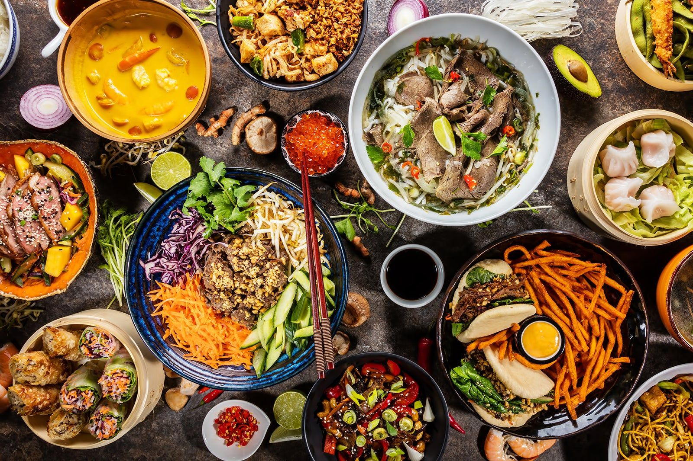

# De quoi vous donner l'eau à la bouche 🤤

**1. Phở**

 Le phở est une spécialité vietnamienne célébrée dans le monde entier. Elle varie selon les régions. Dans le sud, elle est plus douce, avec des épices comme le clou de girofle et la coriandre, tandis que dans le nord, d'où le phở est originaire en tant que plat national du Vietnam, on savoure une version plus épicée avec des nouilles plus larges.

Le phở séduit par sa simplicité : un mélange de bouillon, de nouilles de riz et d'herbes fraîches qui réchauffe l'âme et le corps. À l'origine, les travailleurs des rizières du nord du pays le mangeaient au petit-déjeuner. Aujourd'hui, le phở se déguste à toute heure de la journée, que ce soit dans la rue ou dans les restaurants haut de gamme.

 **2. Bánh mì**

 Le bánh mì, un plat typique du Vietnam, est un symbole de fusion culinaire. Originaire de Saigon (ou Hô Chi Minh Ville), il combine le meilleur de la cuisine française et vietnamienne. Ce sandwich de baguette croustillante, garni de viande, de fromage, de légumes frais et marinés, de beurre et de sauce chili, se trouve dans tout le pays.

Le bánh mì est un exemple typique de street food. Il représente la diversité de ce que vous pouvez manger au Vietnam : à Hanoi, vous trouverez des variantes plus simples, tandis qu'à Hô Chi Minh Ville, il est plus riche en sauce, ce qui montre la préférence régionale pour des saveurs plus intenses.

**3. Gỏi cuốn**

 Le gỏi cuốn, un plat vietnamien typique, offre une alternative croquante et fraîche lors des journées chaudes. Connus dans le monde entier sous le nom de rouleaux de printemps, ce plat combine des ingrédients frais comme des crevettes, de la viande de porc, du basilic thaï, de la ciboulette chinoise, des vermicelles de riz, des cacahuètes et de la salade, le tout enveloppé dans une feuille de riz souple qui laisse transparaître les ingrédients.

Les rouleaux sont trempés dans du nước chấm, une sauce classique vietnamienne à base de citron vert et de poisson, ou dans de la sauce aux cacahuètes, afin de révéler toute leur saveur. Les gỏi cuốn sont pauvres en graisses et riches en vitamines. Ils sont disponibles dans tout le Vietnam et constituent une option saine et polyvalente qui plaît au plus grand nombre.

  **4. Bánh xèo**

 Le bánh xèo est un délice croustillant en forme de crêpe et fourré de crevettes, de viande de porc, d'herbes, d'oignons et de pousses de soja. Nommée d'après le sifflement qui se produit lorsque la pâte entre en contact avec la poêle chaude, cette « crêpe qui grésille » se prépare avec de la farine de riz, du curcuma, de la crème de coco et de l'eau et ressemble à une sorte d'omelette, bien qu'aucun œuf ne soit utilisé.

Servi dans des feuilles de salade, avec des herbes telles que la menthe et la coriandre, et trempé dans du nước chấm, il exalte les saveurs. Le bánh xèo offre une expérience gustative inoubliable. Beaucoup affirment d'ailleurs qu'il s'agit de la meilleure spécialité du Vietnam.
  
  **5. Mì Quảng**

 Originaire du centre du Vietnam, le mì Quảng est connu pour ses nouilles jaunes et ses accompagnements variés. Considéré comme le plus grand concurrent du pho, il contient du bouillon, des oignons nouveaux, de la salade, des fleurs de bananier, des protéines comme le bœuf, le porc ou les crevettes.

On l'accompagne de curcuma, d'œufs de caille, de cacahuètes, de légumes ou de crackers de riz. Cette spécialité vietnamienne combine le meilleur de la soupe et de la salade. On la sert dans tout le Vietnam dans une grande variété de variations. Une combinaison harmonieuse des cinq éléments et un must pour tous ceux qui veulent découvrir la cuisine vietnamienne.
  
**6. Chả cá Lã Vọng**

 Le chả cá Lã Vọng, ou cha ca, est un plat vietnamien traditionnel de Hanoi. Il s'agit d'un poisson frit, mariné dans une sauce à base de curcuma, d'ail, d'aneth, de pâte de crevettes, de piment et de gingembre. On le grille avant de le servir dans une poêle chaude, accompagné de vermicelles, de cacahuètes et d'herbes fraîches.

Vous trouverez le cha ca plutôt dans les restaurants que dans la rue et il est traditionnellement préparé à table. Le bruit du grill et l'odeur alléchante font partie intégrante du repas. Sa combinaison unique mêlant signification culturelle et saveurs variées en font une expérience culinaire mémorable.
  
**7. Bò kho**

 Le bò kho est un ragoût qui se prépare en faisant mijoter des jarrets de bœuf dans un bouillon à base d'eau de noix de coco, de citronnelle, de gingembre, de cannelle et d'anis étoilé. Ce plat vietnamien typique ressemble à une chaleureuse étreinte venue du sud du Vietnam.

On ajoute parfois des carottes, des navets ou des pommes de terre au ragoût avant de le servir avec du riz ou des nouilles et, bien sûr, avec une baguette vietnamienne croustillante. Cette dernière absorbe parfaitement le délicieux bouillon et fait de ce ragoût un plat idéal pour les jours plus frais. Garni de basilic thaï, de citron vert, de germes de haricots mungo et de coriandre, le bò kho est un incontournable parmi les spécialités vietnamiennes.
  
**8. Cá kho tộ**

 Le cá kho tộ, un plat typique du sud du Vietnam, se compose de poisson caramélisé, sucré et salé, cuit dans une délicieuse sauce appelée nước màu. Il se prépare et se sert dans un pot en terre cuite.

Ce plat est souvent cuisiné à base de poissons populaires tels que le poisson à tête de serpent ou le poisson-chat, tous deux appréciés pour leur grande quantité de chair et leur faible quantité d'arêtes. Du riz cuit à la vapeur, des légumes et des cébettes complètent le plat. Cherchez les pots en terre cuite typiques et dégustez le cá kho tộ aussi bien dans les restaurants que sur les stands de rue.
  
**9. Bánh bao bánh vạc**

 Les bánh bao bánh vạc sont également appelés « roses blanches », car leur forme rappelle une fleur. Il s'agit d'une spécialité nord-vietnamienne qui trouve son origine à Hoi An.

Ces raviolis, servis avec une sauce à tremper sucrée, se composent de deux variantes : bánh bao, farci de porc et de champignons, et bánh vac, farci de crevettes. De l'ail frit couronne le plat et lui confère une texture croustillante. La vue des bánh bao bánh vạc est déjà un plaisir en soi, mais pensez à les goûter.
  
  **10. Chè ba màu**

 Le chè ba màu, également connu sous le nom de « dessert tricolore », est un incontournable de tout voyage culinaire au Vietnam. Présenté en couches dans un verre haut, il se compose de pâte de haricots mungo jaunes, de haricots rouges et de gelée de pandan verte, le tout complété par de la crème de coco et de la glace pilée. Une fois mélangés, ces ingrédients offrent un dessert étonnamment croquant et rafraîchissant, très apprécié lors des chaudes journées tropicales. On le trouve partout, sur les marchés comme sur les stands de rue. 

Le chè ba màu est un dessert visuellement attrayant et délicieux, offrant une grande variété de textures et de saveurs.

Et bon appétit bien sûr !

Source: [Tourlane](https://www.tourlane.fr/asie/vietnam/specialites-culinaires/)
