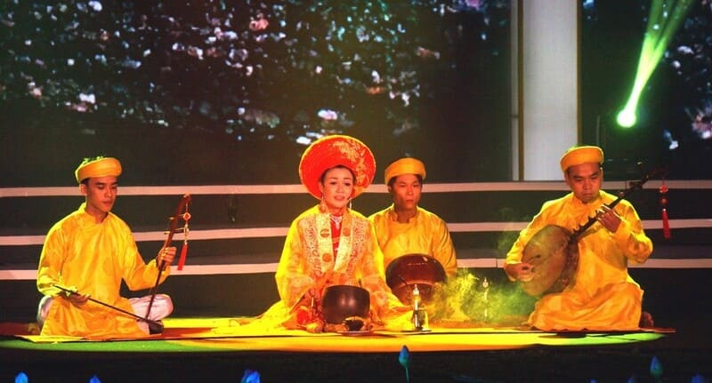

# Prêts à voyager sans bouger de chez vous ? Alors c'est parti !

Il existe différents styles musicaux au Việt Nam, de quoi satisfaire n'importe qui. Cependant, il en existe tellement qu'aujourd'hui, je vais vous introduire à seulement 3 d'entre eux. j'espère que vous êtes prêts !

**1. Tuồng cải-lương**

Tuồng cải-lương ( peut signifier «théâtre réformé») est une forme d'opéra folklorique moderne au Viêt-Nam. Cet art mêle des chants folkloriques du Sud du Viêt-Nam, de la musique classique, du tuồng (forme de théâtre classique inspirée de l'opéra chinois) et du théâtre parlé moderne. 
L'accompagnement repose sur des instruments traditionnels vietnamiens spécifiques :
	• La cithare à seize cordes (Đàn tranh)
	• Le monocorde (Đàn bầu)
	• Le luth à long manche (Đàn kim)
	• La vièle à deux cordes (Đàn cò)
	• La flûte en bambou (Sáo)
	• Des guitares modernes modifiées avec des frettes creuses pour permettre des effets de vibrato particuliers.
À travers ce style musical, vous retrouverez des histoires et des sentiments forts, qui vous feront vous sentir presque bouleversé. Fermez les yeux, et vous vous retrouverez immédiatement au Việt Nam. 
Ce style peut ne pas plaire à tout le monde, mais il est particulièrement important dans la culture musicale Vietnamienne.

N'hésiter pas à essayer, [ça](https://www.youtube.com/watch?v=p1Ws6V8aA5c) ne peut pas vous faire de mal. 😉

**2. Le Boléro Vietnamien**

Le boléro vietnamien (nhạc boléro) est un genre musical populaire et nostalgique, né dans le Sud du Vietnam dans les années 1950 et très apprécié dans les années 1960.  Il s'agit d'une adaptation locale et vietnamienne du boléro latino-américain, fortement ancrée dans la culture du Sud du Vietnam.  C'est une musique profondément nostalgique, mélodancolique, souvent liée aux thèmes de l'amour perdu, de la guerre, de l'exil ou de la vie quotidienne. On l'écoute aussi bien dans les cafés que lors de réunions de famille.
Vous trouverez sûrement ce style plus facile à écouté que le cải-lương et c'est bien normal. Si vous allez un jour dans le Sud du Việt Nam, je peux vous assurer que vous entendrez passer ce genre de musique à un moment ou à un autre.

Venez par [ici](https://www.youtube.com/watch?v=mnMaWQMGI1o&list=RDmnMaWQMGI1o&start_radio=1) si vous souhaitez écouter quelques classiques.

**3. Vinahouse**

Le Vinahouse est un genre musical électronique populaire né au Vietnam dans les années 1990.  Il a vu le jour dans les discothèques et les boîtes de nuit au Vietnam avant de se propager via la diaspora vietnamienne (notamment en Californie et en Australie). Il s'agit d'une fusion de chansons pop vietnamiennes (ou de rock, de country) avec des rythmes de house et de basse. 
Si vous n'avez toujours pas été convaincu par les style précédant, ou que vous souhaitez un style plus rythmé, vous avez choisi le bon endroit.

La Vinahouse est maintenant partout au Việt Nam, où que vous alliez, vous serez sûr d'en entendre autour de vous; magasins, centres commerciaux, cafés, etc. C'est [lestyle parfait](https://www.youtube.com/watch?v=uxAH4t6p1RQ&list=RDuxAH4t6p1RQ&start_radio=1) pour voyager à moindre prix.
